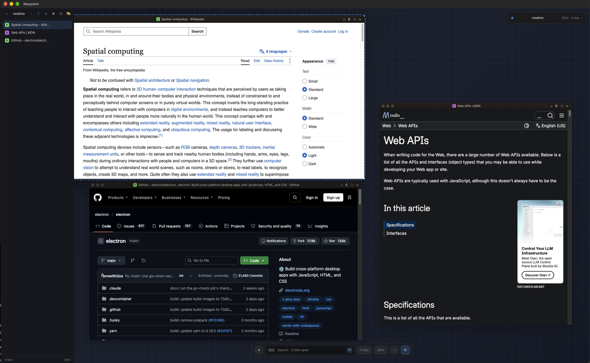

# Waypoint

A local-first, private spatial canvas browser. One infinite pannable/zoomable
surface hosts any number of independent web tiles; each tile is a real
`WebContentsView` with its own cookie jar, cache and storage, and every
workspace is a plain JSON file on disk. No analytics, no network calls of its
own, no accounts.

Electron 45 · TypeScript · esbuild · vanilla DOM/CSS.



## Requirements

- macOS on Apple Silicon (`arm64`). The packaged bundle is arm64 only.
- Node.js 20 or newer — for building and testing only; the app ships its own Chromium.
- Xcode Command Line Tools (`clang`, `codesign`) for `npm run build:app` and the nightly helper.

Nothing to configure and no account to create: the app contacts no service of its own.

## Quick start

```bash
git clone https://github.com/rpmalouin/waypoint.git
cd waypoint
npm install
npm start          # builds dist/ and launches the app
```

Other scripts:

| command | what it does |
| --- | --- |
| `npm run build` | bundle main, preloads and both renderer pages into `dist/` |
| `npm run typecheck` | TypeScript diagnostics over `src/` and `tests/` |
| `npm test` | `node:test` suite over the pure modules |
| `npm run check` | typecheck + tests |
| `npm run smoke` | end-to-end run: drives the real UI and asserts on live DOM and view state, exits 0/1 |
| `WAYPOINT_SMOKE_NET=1 npm run smoke` | the above plus a live `https://example.com` load |
| `npm run dev` | esbuild watch mode (reload the window with ⌘R after a rebuild) |
| `npm run package:mac` | build and assemble `dist/Waypoint-darwin-arm64/Waypoint.app` (unsigned) |
| `npm run build:app` | gates → package → verify → ad-hoc sign → run the staged bundle's own smoke suite → install to `/Applications` |
| `./scripts/nightly-update.sh --self-check` | report the environment and the Electron version pair; changes nothing |
| `./scripts/nightly-update.sh --dry-run` | print every command the nightly would run; changes nothing |
| `./scripts/install-nightly-agent.sh --install` | build/sign the nightly helper and write the LaunchAgent (then: grant it access, `launchctl bootstrap`) |

## Packaging as a macOS app

`npm run build:app` produces a standalone app at `/Applications/Waypoint.app`
(also left in `dist/Waypoint-darwin-arm64/`), arm64 only, ad-hoc signed, and
self-verifying: it runs the app's full smoke suite from inside the staged bundle, and only
then installs it.

```
npm run build:app                     # the whole pipeline
SKIP_GATES=1 ./scripts/build-app.sh    # reuse the last green gates while iterating on packaging
SKIP_LAUNCH=1 ./scripts/build-app.sh   # skip the bundled smoke run
SKIP_INSTALL=1 ./scripts/build-app.sh  # leave the bundle in dist/, touch nothing in /Applications
```

What the pipeline guarantees, in order:

- **Gates first.** `npm run check` and `npm run smoke` run against the tree being packaged, so a
  bundle cannot be built from code the tests have not seen.
- **The bundle is complete and nothing more.** main resolves every page, preload and data file
  relative to its own directory, so `dist/main/*.txt` and all four built entry points must be
  present; sources, tests, the agent docs, sourcemaps and `node_modules` must not. Both lists are
  asserted, and breaking either one fails the build (`bundle is missing …` / `bundle carries …`).
- **The plist says what the folder says.** `CFBundleIdentifier` is `com.local.waypoint`,
  `CFBundleName`/`CFBundleDisplayName`/`CFBundleExecutable` are `Waypoint`, and the binary
  is arm64 — each read back out of the finished bundle rather than assumed from the config.
- **Signing is ad-hoc and comes after packaging** (`codesign --force --deep --sign -`), because
  rewriting `Info.plist` invalidates the signature the Electron distribution arrived with. The
  signature's own identifier is then checked: `--verify` is happy to validate a bundle signed as
  `Identifier=Electron`, and that mismatch is what breaks per-app permissions later.
- **Install is a mirror**, `rsync -a --delete` into `/Applications/Waypoint.app` — stale
  files from an older build go, and no other app in `/Applications` is ever in scope. **No sudo**:
  `/Applications` is group-admin writable, and the script refuses rather than prompting if it is
  not. If the app is running from `/Applications`, the script stops and asks you to quit it; it
  will not kill your windows.
- **The launch assertion is the app running, not a window appearing.** The staged bundle executes
  its own `--smoke` suite with a throwaway config and user-data dir, so a missing preload or a bad
  relative path fails the build instead of greeting you with a blank canvas.
- **The assertion runs before the install, and that order is the guarantee.** A check that runs
  after the copy can only report a failure, it cannot prevent one: on 2026-11-02 a red smoke
  assertion left `/Applications` already overwritten with the unverified bundle. The staged bytes
  are what `rsync` copies, and the installed copy is then checked with
  `codesign --verify --deep --strict`. A failing assertion exits with `/Applications` untouched.

Two things this deliberately does not do. There is **no icon** — the repo ships none, and the
bundle keeps Electron's until an `assets/icon.icns` exists, at which point the packaging script
picks it up with no further change. And the app is **ad-hoc signed, not notarised**: it runs
locally because a locally built app carries no quarantine attribute, but `spctl --assess` rejects
it and it cannot be handed to anyone else. Distributing it would need a Developer ID certificate
and notarisation.

One consequence worth knowing: the packaged app's Chromium profile lives in
`~/Library/Application Support/waypoint/`, while workspaces and clips stay under
`~/.config/waypoint/`. The profile path is **pinned in code** (`app.setPath('userData', …)` at the
top of `src/main/index.ts`) rather than inferred, because Electron prefers `productName` over
`name` and would otherwise create `Waypoint` with a capital W. It is the same directory `npm start`
uses, so the packaged build and a dev run share cookies and container jars — convenient, and also
the reason the two are not isolated from each other. The Chromium half is `Partitions/main` and
friends; everything you care about in a workspace file is in `~/.config/waypoint/`.

`npm run build` wipes `dist/`, so the packaged bundle is a build artefact that a plain build
deletes; `npm run build:app` recreates it. The installed app in `/Applications` is unaffected.

## Nightly maintenance (opt-in)

`scripts/nightly-update.sh` keeps Electron current without a human watching. It is not installed by
default; `scripts/install-nightly-agent.sh --install` sets it up, and the LaunchAgent it writes runs
it daily at **03:30**.

Order, and why the order is not negotiable:

1. **Preflight** — the repo is readable, the toolchain is on `PATH` (`launchd` gives a job almost no
   environment), and one run at a time (a lock directory in `/tmp`, stale after 3 h).
2. **Version check** — `npm view electron version` against `package.json`. Equal → `NIGHTLY_OK
   up-to-date`, exit 0. That is the ordinary outcome, not a failure.
3. **Major guard** — a bump that changes the major is logged and skipped (`NIGHTLY_SKIPPED
   major-available`) unless `ALLOW_MAJOR=1`. Gates are good, but a Chromium major landing unattended
   at 03:30 is a surprise, not maintenance.
4. **Bump** — `npm install --save-dev electron@<version>`, then the binary is *proven* present: npm 11
   can install the `electron` package without running its postinstall, which leaves a shim with no
   `dist/` and fails much later, at smoke, with a confusing error. If it is missing the pipeline runs
   the package's own `install.js`; if that fails too, it reverts.
5. **Gates** — `npm run check`, then `npm run smoke`. Any failure reverts exactly two files
   (`package.json`, `package-lock.json`) — not the whole tree, because a long run is a long window
   and this repo can be edited while the nightly works — and exits 1. `/Applications` is never
   touched on this path.
6. **Build** — `SKIP_GATES=1 SKIP_INSTALL=1 scripts/build-app.sh`: packaged, verified, signed, and
   smoke-run from inside the bundle, still not installed. The gates are skipped here only because
   they just ran against this exact tree.
7. **Commit** — `chore(deps): bump electron to <version> (Chromium upgrade) [automated]`, and only
   if the working tree contains *exactly* those two files. Anything else that appeared during the run
   is a human's work: the pipeline aborts and reverts rather than sweeping it into a machine commit.
8. **Install** — `SKIP_GATES=1 SKIP_PACKAGE=1 SKIP_LAUNCH=1 scripts/build-app.sh` installs the bundle
   that was just verified. If the app is open the install refuses (it will not kill your windows) and
   the run exits **75**: the bump is committed and verified, `/Applications` is behind, and the log
   says which.
9. **Graph** — rebuild the code graph; a failure here is a warning, not a failed run.

Exit codes: `0` nothing to do or done · `1` a gate, the build or the commit failed and was reverted ·
`64` bad usage · `75` committed but not installed · `78` environment (volume, TCC, toolchain or
registry) — nothing was attempted.

`--self-check` reports the environment and the version pair without changing anything;
`--dry-run` prints every command it would run. The log is the LaunchAgent's own stdout/stderr at
`~/Library/Logs/waypoint-nightly.log` (one writer, appended, and it survives reboots — a run
that failed overnight is still there at noon). `scripts/install-nightly-agent.sh --status` tails it
along with the job's load state and the grant rows. One run a night writes a few KB on the no-op
path, so nothing rotates it.

`StartCalendarInterval` is not cron: if the Mac is asleep at 03:30, launchd runs the job **on wake**
and coalesces any further missed intervals into that single run (`man launchd.plist`). So a closed
lid delays the bump; it does not lose it.

### Why the job runs from a helper app

This repository is developed on an external volume, which is the case the helper exists for. Since
macOS 26 a launchd-spawned **bare interpreter** has no responsible app, so no privacy grant can
apply to it, and every read of an external volume fails with `Operation not permitted` — while the
identical script works in Terminal, which *is* a responsible app with grants. So the LaunchAgent
points at a tiny `LSUIElement` app, `/Applications/WaypointNightly.app`, which fork/execs
`/bin/bash scripts/nightly-update.sh`; the child's file accesses attribute to the app and inherit
its grant. On a repository that lives in `$HOME` the helper is unnecessary, but it is harmless.

Two steps are yours, because both are system policy:

```
1. System Settings -> Privacy & Security -> Full Disk Access -> + -> WaypointNightly.app
   (or the narrower "Removable Volumes" service, which is what actually gates external volumes)

2. ./scripts/install-nightly-agent.sh --reload
   from a plain Terminal: loading a job is the one thing an agent shell or CI sandbox may refuse,
   so run it yourself. --reload is bootout + bootstrap + kickstart + the log tail; it reloads even
   when the job is already loaded, which is the case that matters (see the trap below).
```

**Editing the plist does not change a loaded job.** launchd reads the file once at load time and
keeps that definition; rewriting the file afterwards leaves the job running its old copy — measured
here: a log-path change landed in the file at 20:23 and the loaded job still pointed at `/tmp` until
it was booted out and bootstrapped again. So after any plist edit, run `--reload`, and `--status`
now reports `STALE:` when the loaded job disagrees with the file:

```
plutil -extract StandardOutPath raw -o - ~/Library/LaunchAgents/com.local.waypoint.nightly.plist
./scripts/install-nightly-agent.sh --status
```

Verify the grant before trusting 03:30 — the load test has to happen *inside launchd's context*, so
the helper run by hand from Terminal is not proof (Terminal is a responsible app with its own
grants; the nightly is not):

```
./scripts/install-nightly-agent.sh --reload        # loads it and runs it once, prints the tail
```

A green run looks like the one measured on this machine:

```
[2026-11-01 20:31:02] launcher pid=48859 -> .../scripts/nightly-update.sh
[20:31:03]    repo: .../waypoint at c1bd72e (main)
[20:31:03]    installed: electron 45.2.1
[20:31:04]    latest:    electron 45.2.1
[20:31:04]    electron 45.2.1 is already the target version
NIGHTLY_OK up-to-date electron=45.2.1
```

`TCC refused access to …` instead means the grant did not take, and the nightly will log
exactly that at 03:30 rather than pretending there was no upgrade.

The grant is bound to the helper's code signature: recompiling or re-signing it
(`--rebuild-helper`) invalidates the grant and you must re-grant. To stop the job:
`./scripts/install-nightly-agent.sh --uninstall` (add `--remove-helper` to delete the app too).


## Using it

- **New tile** — `⌘N` opens the dock omnibox; Enter spawns the tile at the cursor if
  that space is free, otherwise in the nearest clear slot to the last focused tile (it
  walks the canvas in 40px steps right, down, then diagonally). **Double-clicking empty
  canvas** does the same thing at the point you clicked, and while the canvas is empty a
  centred hint names those keys until the first tile exists. A spawn never lands on
  top of an existing tile: tile chrome is canvas DOM while every tile's page is a
  native view painted above it, so a tile dropped on another one would lose its title
  bar and be impossible to move or close. Bare words become a DuckDuckGo search, hosts
  like `example.com` get `https://`, `localhost:3000` gets `http://`.
- **HUD** — the small pill in the top-right corner names the current workspace and shows
  `zoom% · N tiles`, live. Clicking it opens the workspace switcher, which is the same list
  the sidebar header opens. It is its own native view above every tile, so no page can cover
  it — that is why the status is readable while ten tiles are stacked over the canvas.
- **Containers** — prefix the omnibox to open the tile in a session of its own:
  `@work https://github.com` or `work:https://github.com` (persistent, its own
  cookie jar on disk), `@temp https://example.com` or `temp:https://example.com`
  (in memory, gone at quit), or the canonical `persist:work <url>` /
  `temp:scratch <url>`. A tile outside the shared jar wears a small pill in its
  title bar — slate for a persistent container, amber for a private one — and no
  prefix means the usual shared session, unbadged. The sidebar's `⧉` panel manages
  the jars that exist: pick one for the next tile, move an open tile into another,
  or clear one jar's cookies. Its **new container** field mints one by name — letters,
  digits, `-` and `_`, 1–64 characters — which either arms the omnibox with `@name ` or, in
  move mode, drops the tile whose `⇄` opened the panel into a jar that did not exist yet.
  Nothing is stored to record a container: the list is read from the tiles that are open, so
  a jar stops appearing when its last tile closes — and since the panel can only clear a jar
  it is listing, that storage is out of reach from the UI until a tile uses it again. The
  `persist:` directory under the profile is what is left behind.
- **Dark mode per tile** — the `◐` button in a tile's title bar inverts that page and
  only that page, with one injected stylesheet and no extension. It survives navigation,
  reloads and container moves, and the workspace records it only while it is on. See
  *Per-tile dark mode* below for the one artefact it costs.
- **Clip a page** — `❧` extracts the page (selection first, then `<article>`/`<main>`,
  then the body) into a markdown note with `title`/`source`/`clipped` frontmatter, written
  atomically into `<config>/clips` or wherever `WAYPOINT_CLIP_DIR` points. The button shows
  `✓` for 1.5 s, or `✕` and a stderr line when it cannot.
- **Bookmarks** — `☆` in a tile's title bar keeps the current page in
  `<config>/bookmarks.json` and fills in to `★`; a second press forgets it. The page keeps
  the container it was saved from, so reopening it lands in the same jar. Type in the dock's
  omnibox and saved pages appear as amber suggestions — click one to open it, Tab to complete
  its address — and the sidebar's `★` opens the shelf: every bookmark, newest first, one
  click to open, `✕` to forget. Right-clicking a link offers *Bookmark Link* (and *Remove
  Bookmark* once it is saved). See *Bookmarks* below.
- **Edit text anywhere** — `⌘C`, `⌘V`, `⌘X`, `⌘A` and `⌘Z` act on whichever document has
  focus: a tile's page, the dock's omnibox, a sidebar field, the theme's hex input. The Edit
  items are custom rather than `role:`s, because Electron's role handlers reach for the focused
  BrowserWindow and this shell is a `BaseWindow` — see *Menu workarounds* below.
- **Right-click** — inside a tile: *Open Link in New Tile* (the link opens in that tile's own
  container, like a `target=_blank` popup), *Copy Link Address*, *Bookmark Link* (which the same
  menu turns into *Remove Bookmark* once the address is saved), the edit commands when the
  pointer is over a field, or *Copy* / *Search DuckDuckGo* for a read-only selection. The app's
  own inputs get the same menu. A right-click on empty space offers nothing and opens nothing.
- **Pan** — middle-mouse drag pans anywhere on the canvas, and the dock's hand
  tool (`✋`) latches pan so a plain left drag pans over any tile, even dense
  clusters. `Space` is not a pan key: it belongs to the page you are in.
- **Zoom** — scroll wheel or trackpad pinch, clamped to 0.25×–2.0× and centred on
  the cursor. Two-finger trackpad scrolling pans instead of zooming (see
  `classifyWheel` in `src/shared/math.ts`).
- **Zoom shortcuts** — click the dock's zoom pill to snap back to exactly 100%
  around the view centre; double-click it (or press `F`, or the dock's ⤢ button) to
  frame every tile: the bounding box of all tiles with 40px of padding, zoom clamped
  to 0.25×–1.5×.
- **Dock counter** — the `3 tiles` pill shows how many tiles are open and toggles the
  sidebar. Typing `@` (or `work:`) in the omnibox swaps the controls for container
  chips naming the containers already in use, plus `temp`; clicking one completes the
  prefix (`@isolated `), Tab takes the first, Enter still opens. Typing anything else
  matches bookmarks instead: a title, host or address fragment offers up to four saved
  pages as amber rows, click to open one, Tab to complete its address.
- **Sidebar** — 280px, `⌘\` or `⌘B` collapses it to a 44px rail and back. Each row
  shows the favicon, the live page title, the tile's container pill, a hover `⇄` to
  move the tile into another container and a hover `✕` to close it; a row on a host with
  cosmetic rules also carries a `🛡` that pauses or resumes them (per host, so two tiles on
  one site always agree). Click a row to pan that tile to the viewport centre (zoom
  unchanged) and raise it. The `⧉` in the header opens the containers panel (pick, move,
  clear), `★` the bookmark shelf, `▤` the layer panel (front-to-back order, bring to front,
  send to back) and `🎨` the theme inspector.
- **Workspaces** — the sidebar header names the current workspace and opens a
  dropdown on click: *+ New workspace* (an empty canvas saved under `untitled`,
  `untitled-2`, …), every saved workspace, and the save action (`⇩`, or `⌘S`).
  `⌘L` puts the caret in the dock's omnibox, like `⌘N`.
- **Move / resize a tile** — drag its title bar; select it and drag any of the four
  corner grips to resize freely from that corner, anchored at the opposite one.
  Minimum 320×240 world units.
- **Tile chrome** — three macOS-style lights on the left: **red** closes the tile,
  **yellow** collapses it to its title bar (and again to restore the height it had),
  **green** flies the camera to it without moving the tile itself. The rest of the bar is
  the drag handle: favicon, the container pill when the tile is in a jar of its own, and the
  live page title. On the right, in order: `‹` `›` walk the page's history, `↻` reloads it,
  `◐` is dark mode, `☆` is the bookmark and `❧` is the clipper — those last three have their
  own sections below.
- **A tile has no address bar.** An open tile goes where its page takes it — a link in the
  page, back, forward, a reload — and a different address is a *new* tile from the dock's
  omnibox (`⌘N`). Right-click → *Open Link in New Tile* and *Search DuckDuckGo* open tiles
  too. The list above is every control in the title bar; nothing is hidden behind a mode.
  A frame dragged narrow goes *compact* and drops controls in a fixed order — the traffic
  lights and `‹` `›` first, then `◐` `☆` `❧` — leaving the title and `↻`;
  a compact tile is closed from its sidebar row.
- **Selection** — click a tile to select it: a 2px dashed ring 3px outside its edge
  and four 10px grips centred on its corners, which only exist while it is
  selected. **Shift-click** adds a tile to the selection or takes it out again, and
  **dragging on empty canvas** draws a rubberband box that selects every tile it
  covers (shift keeps what is already selected). Dragging any selected tile moves
  the whole selection by that delta. The sidebar mirrors the selection.
- **Frames** — `⌘G` mints a named zone around the *selection* when there is one,
  and around every tile when there is not. Drag the header pill to move the zone
  *and* every tile whose centre it holds; drag the bottom-right handle to resize it;
  double-click the header to rename it; click the dot in the header (visible on
  hover) for a six-swatch tint row; the `✕` in the header removes the zone without
  touching its tiles.
  A frame is an annotation, never a group: it does not close, zoom or fill what is
  inside it.
- **Theming** — every workspace carries a theme: a palette derived from one base hue by
  a harmony (`free`, `complement`, `analogous`, `triad`, `split`), painted as a gradient
  across the canvas with optional grain, and followed by the dock and the sidebar as a
  tint mixed from its first stop. The `🎨` button in the sidebar header opens the
  inspector in flow — harmony, day/night, hue, vivid, grain, angle and the resolved
  stops. The gradient is real; the chrome's glass is a solid tint, because a sibling
  view cannot sample the pixels behind it.
- **Workspace files** — the switcher's menu carries *Rename* (inline in the header;
  Enter or blur commits, Escape reverts), *Duplicate* (`<name>-copy.json`, then
  `-copy-2`, …; switches to the copy) and *Delete* (two presses, because it sits
  next to a list of similar names). Workspace names are `[a-z0-9._-]`, up to 64
  characters, and never overwrite an existing file. The last workspace is never
  removed outright: it is replaced by an empty `scratch.json`.
- **Autosave** — `⌘S` is still there, but you do not need it. Any change to the canvas
  (a tile added, closed, moved or resized, a page that navigates, a frame, a theme, a
  pan or a zoom) is written to the active workspace file about half a second after you
  stop moving. Closing the window or quitting flushes whatever the timer has not
  reached yet, before the window goes, so a rearrange survives a quit that follows it
  immediately.
- **Launch** — the last workspace you had open is restored, at the camera position and
  zoom you left it at, with the window at the size and maximized state you left it in.
  There is nothing to open by hand.

## Architecture

```
src/
  main/
    index.ts       BaseWindow shell, IPC, overlay mode machine, quit-time flush
    registry.ts    Map<tileId, WebContentsView> — partitions, liveness, dead map
    menu.ts        the application menu and the right-click menus (see the BaseWindow note)
    adblock.ts     per-session ad/tracker blocker instance
    adblock/       bundled blocklist.txt and cosmetic.txt (copied to dist/main/ by the build)
    cosmetic.ts    the cosmetic rule set and the per-host pause list
    sessions.ts    bounded cookie flush (one budget for every persistent store)
    workspaces.ts  flat JSON persistence, atomic writes, input coercion
    bookmarks.ts   the bookmarks file: one in-memory copy, serialised atomic writes
    validate.ts    every renderer payload is untrusted: clamp, coerce, reject
    smoke.ts       end-to-end assertions driven through the real bridge
  preload/
    canvas.ts      window.canvasBridge (fixed channels only, no ipcRenderer)
    overlay.ts     window.overlayBridge (region-aware, three views)
  renderer/
    main.ts        world model, rAF geometry pipeline, workspace apply/collect, frames
    tiles.ts       one DOM frame + chrome bar per tile (traffic lights, selection, grips)
    frames.ts      named zones: drag-by-centre carrying, inline rename, corner resize
    pointer.ts     best-effort pointer capture (a refused capture must not abort a gesture)
    input.ts       pan/zoom/omnibox key bindings
    overlay/       HUD (main/dock/sidebar), modals, pan interceptor
  shared/
    math.ts        world↔screen transforms, zoom-at-cursor, URL normalisation
    types.ts       IPC data shapes
    channels.ts    the complete channel list
    context-menu.ts  what a right-click offers, as data (link / editable / selection blocks)
    bookmarks.ts   BookmarkRecord, the canonical URL key, the deterministic id, matching
    bridge.ts      the preload contract (typed both sides)
    constants.ts   zoom bounds, chrome geometry, partitions
    session-partition.ts  default jar, container vocabulary, omnibox prefix parsing, validation,
                          container menu helpers (choice list, omnibox prefix for a jar)
    adblock.ts     the blocking decision: host matching, mainFrame/same-site rules
    cosmetic.ts    the cosmetic rule language, selector validation, CSS compilation
    frame-color.ts the zone palette and the one `#rrggbb` validator (loader + renderer)
    color.ts       HSL/RGB maths, harmony stop hues, palette generation, gradient strings
    theme.ts       WorkspaceTheme, DEFAULT_THEME, and the one coercion rule
    pan-mode.ts    pure pan state machine: hand tool, modal precedence
```

### Three layers, one window

`BaseWindow.contentView` holds four kinds of child view, bottom to top:

1. `canvas` — the background renderer. Owns the world model, draws the grid and
   every tile's frame/chrome, and is the only place geometry is computed.
2. one `WebContentsView` per tile, positioned over its frame.
3. `overlay` — three region views loaded from `overlay.html` with different hashes:
   `main` (compact HUD, modals, pan interceptor), `dock` (bottom strip with
   omnibox/tool/counter/zoom controls), `sidebar` (left column with workspace
   switcher and tile list). Only the HUD/pan interceptor ever covers the full window;
   dock and sidebar are sized exactly to their panels so the canvas underneath stays
   clickable.
4. The pan interceptor is a transparent layer *inside* the `main` overlay view.
   When armed (the dock's hand tool is latched) it expands to the full window
   and captures pointer events, solving the mouse contention over tile views.

The split is not cosmetic: child views always paint above their parent's DOM,
so a HUD rendered inside the canvas page would be covered by the first tile.
A dedicated overlay view is the only way to get a real top layer while keeping
one view per tile.

### Coordinate model

Screen space is the window; world space is the infinite plane.
`screen = (world + pan) * zoom`.

`layoutTile()` returns *both* rects for a tile — the full footprint the DOM
draws and the `content` rect handed to `WebContentsView` — so the two cannot
drift apart. Edges are rounded independently and the size derived from the
rounded edges (`right - left`); rounding position and size separately leaves
1px seams that show the canvas through the gap between chrome and page.

`zoom` is applied twice on purpose: the view's `setBounds` shrinks the rect and
`webContents.setZoomFactor(zoom)` scales the page inside it, so tiles behave
like zoomed windows rather than portholes into a 1:1 page.

### Tile chrome and the traffic lights

Every frame is canvas DOM drawn *under* the tile's `WebContentsView`, so the
lights are the one part of a tile that must never be re-parented or covered.
`.lights` sets `-webkit-app-region: no-drag`, its own `pointer-events` and
`z-index: 10`, and stops `pointerdown`/`mousedown` before the title-bar drag
handler sees them. Raising a tile on press bumps its `z-index`; it never moves
the node in the DOM, because re-parenting a pressed node ends Chromium's
implicit mouse capture and the press stops producing a `click` at all.

- red closes the tile: the frame is removed, the view destroyed, and the
  registry count drops.
- yellow collapses it: the frame's height becomes the chrome height,
  `layoutTile()` reports `content.height === 0`, and main hides the view so no
  page paints over the bar. Yellow again restores the previous height.
- green flies the camera to the tile: `fitToView()` on that one rect, eased over
  `CAMERA_FIT_MS` inside the same rAF pipeline that positions the views, so the
  camera and the pages move in lockstep. The tile's world rect is never rewritten.

Hovering anywhere in the group reveals the native `✕ − +` glyphs. A tile opened in
its own container also wears a `.tile-badge` pill between the favicon and the
title — the container's name in slate for a persistent jar, `temp` in amber for an
in-memory one. Shared-jar tiles are unbadged, because that is the default and a
label on every tile would mean nothing.

Three more buttons sit with `‹ › ↻`: `◐` is the tile's dark-mode switch, `☆` is the bookmark
star (below) and `❧` is the clipper (below). They are ordinary `.ctl` buttons, so the chrome's
press handler already ignores them and a press on one raises the tile without starting a drag;
they are the first controls to disappear when the frame narrows into its compact layout,
because at that width the title is worth more than a button whose state the page shows
by itself.

There is **no address field** in a tile. One existed in the MVP; `aa59e34` removed it when the
five-view shell landed, and the bar has been a label plus history/reload since. Navigation
therefore comes from the page itself (its links), from the history buttons, or from a new tile
opened through the dock. The capability that fed the old field — `TileHooks.navigate`, the
`tile:navigate` channel, its main handler and `TileRegistry.navigate()` — was unreachable code
from that day and was deleted on 2026-11-02 rather than left to be mistaken for a control. A tile
cannot be re-pointed; it can be reloaded, walked back and forward, or replaced.

### Menu workarounds

The application menu and every right-click menu are built by hand, and one measured fact is why: in
this shell an item declared as an OS role — `role: 'copy'`, `paste`, and the rest — does nothing.
Electron's role handlers dereference the focused **BrowserWindow**, and a `BaseWindow` holding child
`WebContentsView`s has none, so the handler runs against nothing. Measured on Electron 45.2.1:
invoking the real `role: 'copy'` item with a tile focused and text selected left the clipboard on a
sentinel, while a custom item calling `webContents.copy()` moved it.

So every window-scoped command is a custom item aimed at `webContents.getFocusedWebContents()`, and
only the app-scoped roles (`about`, `hide`, `quit`) stay roles. The menu is the app menu plus Edit
and nothing else: the default View menu binds `⌘0`/`⌘±` to the **guest page's** zoom, fighting the
canvas's own zoom model, and File binds `⌘W` to closing the only window there is.

### Per-tile dark mode

`◐` in a tile's header inverts that page, and only that page. It is one fixed
stylesheet inserted with `webContents.insertCSS()` — no extension, no preload into the
page, and nothing about the workspace's own palette crosses into it. The stylesheet
inverts the root element and rotates its hue back 180°, then inverts images, video,
canvas and SVG a second time so photographs stay photographs; the root gets a near-black
background so an inverted page does not flash white while it loads.

The switch is a *request with an answer*, not a flag the canvas flips. `insertCSS()`
belongs to one live document, so main reports the state the tile actually reached and
the button renders that: on a crashed or closed page the press changes nothing, and the
button goes on saying so instead of claiming a page it could not reach. `darkMode` is
stored on the tile record and written **only when `true`**, so a workspace nobody darkened
keeps the exact file shape it had before this feature.

Injection follows the document, not the tile. Every load gets a fresh CSS key and the
previous one is dropped first, re-inserted on `dom-ready` — before the page settles —
which is what makes dark mode survive a navigation, a reload, and the view rebuild that
moving a tile between containers causes. The flag travels with the tile across that
rebuild; the inserted sheet does not.

The cost is honest and visible: `filter` on the root element creates a containing block,
so a site with a `position: fixed` header will scroll that header with the document while
dark mode is on. That is why this is a per-tile switch and not a global theme — you turn
it on for the page that reads badly light and off for the one that breaks.

### Selection

The selection is a `Set<string>` plus an anchor, not one active id. The set decides
what wears `.tile-selected`; the anchor (`anchorId`, the tile the last press landed
on) is what the cascade in `newTileWorld()` measures from and what the chrome treats
as active — a set alone cannot answer "which one was last".

A press and a click are deliberately different events, because a tile's only
pressable surface is its title bar, which is also its drag handle:

| gesture | press | release (no movement) |
| --- | --- | --- |
| plain, on an unselected tile | selection becomes that tile | nothing |
| plain, on a selected tile | whole selection kept | collapses to that tile |
| shift, on an unselected tile | added to the selection | nothing |
| shift, on a selected tile | selection kept | removed (the toggle) |

Toggling on *press* instead would unselect the very tile a shift-drag is about to
carry, and collapsing on press would make a group drag impossible — so both are
decided on release, behind a 2px slop (`DRAG_SLOP_PX`).

**Dragging moves the selection.** The canvas freezes every selected tile's world
rect at press (`hooks.beginMove`), and each move applies
`translateRect(origin, dx, dy)`. `Tile` no longer writes its own `world` in move
mode — one owner, and a dropped move event cannot drift the group.

**The rubberband is drawn in screen space and hit-tested in world space.** A left
press on empty canvas starts it (middle-drag and the hand tool still pan, which is what
those gestures mean); the box is positioned in pixels, then `screenToWorld()` converts
it once against the live viewport, so the same box selects what it visibly covers at
any zoom. Overlap is strict — a box that only shares an edge selects nothing — which
is the same `intersects()` rule that keeps a flush tile's chrome readable. A box that
has not moved 3px is not a box: the press is the background click it looks like. The
element is `pointer-events: none` and sits at the CSS maximum z-index, because it must
paint over tile chrome without ever taking the pointer that is drawing it.

### Theming

A theme is per workspace, stored as `theme?: WorkspaceTheme`, and it is *derived data
plus its inputs*: `harmony`, `baseHue`, `vivid` and `mode` decide the palette, and
`colors` is the materialised result that actually gets painted. The inspector
regenerates `colors` whenever a control moves (except in `free`, which is the mode that
says the stops are the user's own), so the file always records both what was asked for
and what was shown.

`src/shared/color.ts` is pure arithmetic — HSL/RGB conversion, the four harmony offsets,
`generatePalette()` with its day (70–85% lightness) and night (10–22%) bands, and
`buildCssGradient()` for the string the canvas paints. Nothing in it knows about the DOM
or about storage, so the maths is pinned by unit tests rather than by looking at it.

`src/shared/theme.ts` is the only rule about what a theme may be. `coerceTheme()` builds
a fresh object from named fields, drops anything it does not recognise, and returns
**`undefined` when the result is the default** — which is precisely the condition that
leaves the `theme` key out of the saved file, so a workspace that never touched theming
keeps the file shape it had. `resolveTheme()` is the painting side: always a theme, never
the shared default object, so a caller that mutates what it was handed cannot rewrite the
default for the rest of the process.

The theme travels as **data, not CSS**. The canvas and the chrome are different documents
in different views: there is no cascade between them, and a sibling `WebContentsView`
cannot sample the pixels of the one behind it, so `backdrop-filter` has nothing to blur
across that boundary. Instead:

- either end sends `theme:update` — the canvas echoes what it just applied, the inspector
  sends what the user moved — and **main coerces it once** and broadcasts `theme:changed`
  to the canvas, the overlay, the dock and the sidebar. One entrance, one normalised copy.
- the canvas sets three properties on `#canvas`: `--theme-gradient`, `--theme-base` and
  `--theme-grain-opacity`, and echoes a theme only for a *local* change. Rebroadcasting a
  broadcast would be a loop.
- the chrome sets `--theme-base` on `:root` plus `--theme-sidebar-tint` (14% of the base
  mixed into `#16181d`) and `--theme-dock-tint` (18% into `#1c1e24`). That tint is the
  glass: honest about the compositor, and still the same family as the canvas.

Grain is a `<div id="canvas-grain">` holding an inline `feTurbulence` SVG, first child of
`#canvas` so the grid, zones and tiles paint over it. It is `pointer-events: none` — a
grain layer that took events would end marquee selection and panning silently — and its
opacity is the theme's `grain` percentage.

One trap worth knowing: main's `asSnapshot()` is a **whitelist** that rebuilds the saved
snapshot field by field. A new field on `CanvasSnapshot` that is not added there is
dropped on every save, which looks exactly like the feature forgetting its state.

### Sidebar and dock

The sidebar is a 280px native view, and its collapse is a *bounds* animation in
main (`animateSidebar()`, eased over `SIDEBAR_SLIDE_MS`, 160 ms), not a CSS
`transform: translateX(-100%)`. A child view cannot be hidden by transforming its
content: the view keeps its rectangle, keeps taking clicks over that rectangle, and
the canvas underneath would be dead for 280px of the window. At the end of the
slide the view is a 44px rail — small enough to leave the expand button reachable —
and the panel inside it goes `display:none`. Both halves are asserted in smoke:
the view bounds *and* the panel's computed display.

Rows are rebuilt only when their content changes — the key is an explicit list of the
fields a row draws, which deliberately excludes the layer index, because a raise must
not rebuild the row list under the pointer that just pressed a tile. A row shows the
favicon letter, the live title, the tile's container pill (same partition, same colours
as the title bar) and two hover actions: `⇄` for the container panel and `✕` to close.
Clicking a row sends `tile-focus`; main raises the view and the canvas runs
`panTileToCenter()` — the camera moves so the tile's midpoint lands on the view centre
at the current zoom:

```
panX = viewportWidth / 2 / zoom - (tile.x + tile.w / 2)
panY = viewportHeight / 2 / zoom - (tile.y + tile.h / 2)
```

The containers panel is an *in-flow* block between the header and the row list, the
same shape as the workspace menu, not a popover. It has to be: the sidebar is a native
view, so anything positioned outside its 280px rectangle is not merely clipped, it is
invisible — there is no layer above it to paint into. The panel is rebuilt only when
its content changes (mode, target tile, pending confirmation, container list), because
a rebuild on every status tick would drop a half-pressed confirmation.

### Layer order

Click-to-raise has always decided what paints in front; the `▤` button in the sidebar
header makes that order visible and settable. The panel is a fourth in-flow block,
listed front to back, with `▲` to bring a row to the front and `▼` to send it to the
back. The one button that would do nothing — raising the topmost row, sinking the
bottom one — is disabled rather than quietly accepted.

The order is a single list of tile ids in the canvas renderer, `state.stack`, stored
**back to front** (index 0 paints at the back) because that is the direction it is
applied in. Both layers are derived from it, so they cannot drift:

- the DOM writes `index + 1` into each tile's inline `z-index`, as `style` only — never
  by re-ordering nodes, because re-parenting a pressed node ends Chromium's implicit
  mouse capture;
- main re-adds each `WebContentsView` in list order (`CH.tileStack` →
  `TileRegistry.applyStack`) and then restores the chrome above them. There is no
  per-view z-index, so a permutation costs one remove/add per tile: only an explicit
  panel action pays that, while a press stays a single `focusTile` plus one counter
  increment.
- a press is a raise. A raise moves the id to the end of the list, and that is the only
  rule — the press path and the panel cannot disagree about where the front is.

Persistence follows the `frames` and `theme` convention: `stack?: string[]` on the
workspace, written only when the order differs from creation order, so a workspace
nobody re-ordered keeps its exact file shape. The loader validates through
`normalizeLayerOrder()` in `src/shared/layers.ts` — unknown ids dropped, duplicates
dropped, ids the list forgot appended — and a restored workspace is spawned in list
order, which leaves both layers agreeing at boot with no re-order IPC at all.

The workspace switcher header names the current workspace and opens a dropdown with
*+ New workspace*, the saved workspaces, and the save action. "New" is chosen in
main (`untitled`, `untitled-2`, …) and written to disk immediately, because the
dropdown lists what exists on disk — an unsaved canvas would vanish from it.

The dock is a 620×56 strip centred 24px above the bottom edge. Its counter pill
(`3 tiles`) toggles the sidebar, and typing `@` or `work:` swaps the controls for
container chips. Chips are painted from the dock's own keystrokes (an `input`
listener), not from a config push: typing never crosses IPC, so waiting for the next
status tick to answer a keypress would read as a broken UI. Tab accepts the first
chip, a click completes the prefix, Enter still opens.

Fit is one calculation behind three controls — the `F` key, the dock's ⤢ button and
the green traffic light: bounding box of every tile, `FIT_PADDING` (40px) on each
side, zoom capped at `FIT_MAX_ZOOM` (1.5×) and floored by `MIN_ZOOM` (0.25×). The cap
exists so fitting a single small tile frames it instead of blowing it up to the
window.

### Group frames

A frame is a named rectangle in a `#frames` layer between the canvas background and
the tiles. It is an annotation, not a container: it never groups tiles for close,
zoom or fill, and it only moves tiles when you drag it.

- **Membership is by centre.** Dragging the header moves every tile whose centre —
  inclusive of the frame's edges — lies inside the rectangle, all by the same world
  offset. The set is snapshotted on `pointerdown`, so a tile cannot fall into or out
  of the carried group halfway through the gesture.
- **The body is `pointer-events: none`.** A frame covers a large part of the canvas;
  if it took clicks, the canvas behind it could not be panned or marquee-dragged.
  Only the header pill (drag, rename, `✕`) and the corner handle are hit targets.
- `⌘G` mints a frame around the bounding box of the **selection**, padded by
  `FRAME_PADDING_WORLD` (48). With nothing selected it frames every tile, which is
  what the shortcut did before selection could hold more than one; an empty canvas
  gets a zone at the viewport centre rather than nothing.
- A zone wears a tint from one of six swatches (`FRAME_COLORS`), chosen from the dot
  in its header. The colour is written into `--frame-color`, which the stylesheet
  reads through `--frame-tint` for the border, the body wash, the header pill and the
  resize handle, and into `FrameRecord.color` on the next save. `#rrggbb` is the only
  shape accepted and the rule lives in `src/shared/frame-color.ts`, shared by the
  loader and the renderer — the value lands in CSS, so the guard is the injection
  boundary as well as a style rule.
- Names are trimmed and bounded to 64 characters; renaming happens inline
  (double-click the header), because this renderer has no `window.prompt`.

Frames persist as world-unit geometry, exactly like tiles, so a zone zooms with the
canvas and its border lands on the same rounded edges as the tiles inside it:

```
frames?: Array<{ id, name, worldX, worldY, worldW, worldH, color? }>
```

A workspace with no frames writes no `frames` key at all, which keeps files written
before frames existed byte-identical. Loading is hostile-input safe: ids must match
the tile-id pattern (a `../` id is dropped, not repaired), duplicate ids are dropped,
geometry must be finite, sizes are floored at `MIN_FRAME_WORLD_W/H` (200×140), the
list is capped at `MAX_FRAMES_PER_WORKSPACE`, and a colour is kept only if it is
`#rrggbb` — anything else would be a stylesheet injection into an inline custom
property.

### Selection ring and corner resizing

The selected tile wears a 2px dashed ring at `outline-offset: 3px` and four 10×10
grips centred on its corners, shown only while it is selected. The grips sit *outside*
the tile box on purpose: a tile's page is a `WebContentsView` covering its whole body,
so a handle drawn inside the box could never receive the pointer.

Resizing is free, not proportional. `resizeFree()` works per axis from the grabbed
corner, anchored at the opposite one:

```
se → (w, h)          nw → (x, y, w, h)
ne → (y, w, h)       sw → (x, w, h)
```

Each axis is clamped independently to `MIN_TILE_WORLD_W/H` (320×240) *before* the
origin is derived from the anchor, so a drag past the minimum pins the moving edge
instead of flipping the rect through its own anchor. Mutations only touch the tile's
world rect and call `schedule()`; the `requestAnimationFrame` pass is still the only
place rects and view bounds are computed, so a corner drag cannot emit a subpixel seam
or a per-event IPC message.

Pointer capture is requested **after** a gesture has been recorded and its failure is
swallowed (`src/renderer/pointer.ts`). `setPointerCapture` throws `NotFoundError` for
a pointer that is no longer active — a fast press and release, a synthetic event, a
second press mid-drag — and an uncaught throw there would abort the rest of the
handler: the drag would start with no carried-tile snapshot and no moving class.

### Workspace files

The switcher's menu carries Rename, Duplicate and Delete next to the workspace list.

- **Rename** writes the new file first and unlinks the old one, so a crash between the
  two leaves two copies rather than none. Names must match `[a-z0-9._-]{1,64}`, may not
  contain `..`, and may not collide with an existing workspace (a refused rename never
  touches the source). Renaming the active workspace re-points the status, so the next
  `⌘S` writes to the new name.
- **Duplicate** writes `<name>-copy.json`, then `-copy-2`, … and *switches to the copy*:
  a clone nobody opens is busywork.
- **Delete** is a two-press confirmation — the menu item becomes `Delete "<name>"?` —
  because it sits beside a list of similar-looking names. Deleting the active
  workspace switches to the first remaining one; deleting the last one replaces it
  with an empty `scratch.json` rather than leaving the app with nowhere to put a tile.
- Failures (`rename failed`, `workspace "x" not found`) come back through the IPC
  result and are shown in the menu instead of being swallowed.

### Autosave and the session latch

`workspace:save` is still the one write path — autosave does not have a second
serialiser. The canvas reports that something changed over `canvas:dirty`
(fire-and-forget, no payload); main debounces that for `AUTOSAVE_DEBOUNCE_MS` (500 ms),
then asks the canvas for a snapshot with the ordinary `collect` RPC and writes it
atomically. A drag therefore costs one write when it stops, not one per frame.

Three rules make it safe rather than merely convenient:

- **The name comes from the snapshot.** The canvas answers `collect` with
  `{ …snapshot, workspace }`, and that name is what the file is written under. Main's
  `status.workspace` is a cached copy that a switch leaves behind for one IPC hop, and a
  debounced write aimed with it lands in the workspace you just left.
- **An explicit save or a switch supersedes a queued write.** Both cancel the timer and
  bump an epoch; a collect that was already in flight when the epoch moved is dropped.
- **Both exits flush before anything is destroyed.** `before-quit` and the window's
  `close` each hold the exit (preventDefault), collect within `QUIT_COLLECT_BUDGET_MS`
  (1.5 s, so a wedged renderer cannot make the app unquittable), write, remember the
  window geometry, and only then let the quit or the destroy proceed.

`session.json` is the one file that carries the latch, merged rather than rewritten so
the three writers (`lastWorkspace`, `cosmeticPaused`, `windowBounds`) cannot drop each
other. Geometry is read synchronously at startup — `new BaseWindow` cannot await — and is
used only when the remembered rect still overlaps a display that is attached.

### Throttling

Pan, drag, resize and zoom handlers only mutate state and call `schedule()`.
`schedule()` coalesces into a single `requestAnimationFrame`; that frame is the
only place bounds are computed, and it emits `tile:update-bounds` only for tiles
whose `(x,y,w,h)@zoom` key changed since the last frame. Dragging one tile
across a 40-tile canvas sends one bounds update per changed tile, not one per
mouse event, and never zero-change frames.

### Sessions and containers

Tiles share one persistent session by default (`persist:main`), so signing in to
Google, GitHub or Gemini in one tile signs in every tile, and the login is still
there after a restart. `contextIsolation: true`, `nodeIntegration: false` and
`sandbox: true` are unchanged, and permission requests are still denied by
default — sharing a session shares a login, not trust in the page.

A tile can ask for its own container instead, and that string is saved with the
tile, so a reload reopens it in the same jar:

| partition | cookies live in | survives a restart |
| --- | --- | --- |
| `persist:main` (default) | `Partitions/main` under the user-data dir | yes |
| `persist:<name>` | `Partitions/<name>` | yes |
| `temp:<name>` or a bare `<name>` | memory only | no |

The name after the prefix must match `^[A-Za-z0-9_-]{1,64}$`, so it can never be
a path. Anything else — slashes, dots, `..`, a number — means "no container" and
the tile opens in the shared jar rather than creating a directory from an
untrusted string.

#### Choosing a container from the omnibox

`parseOmniboxInput()` in `src/shared/session-partition.ts` splits the dock's input
into a container and a target, before `normalizeUrl()` sees either:

| input | tile opens in | badge |
| --- | --- | --- |
| `@work https://github.com` | `persist:work` | `work` (slate) |
| `work:https://github.com` | `persist:work` | `work` (slate) |
| `@hoa https://bank.example` | `persist:hoa` | `hoa` (slate) |
| `@temp https://example.com` | `temp:anon-<8 hex>` | `temp` (amber) |
| `temp:scratch https://example.com` | `temp:scratch` | `scratch` (amber) |
| `persist:work https://github.com` | `persist:work` | `work` (slate) |
| `https://example.com`, `example.com`, `localhost:3000` | `persist:main` | none |
| `@../../etc https://example.com` | `persist:main` | none |

Two ordering rules make the vocabulary unambiguous. A URL is recognised before
any prefix rule, because `https://…` carries a colon too, so `https` can never
become a container name; and the colon form needs a target that reads as an
address, so `localhost:3000` stays a host and a port instead of becoming a
container called `localhost`. A malformed prefix is not an error: the address is
still opened, in the shared jar — the same fallback `normalizeTilePartition()`
applies to a hand-edited workspace.

`@temp` deliberately names no jar: every one gets a fresh in-memory store, and
its generated `anon-<hex>` name collapses to a `temp` pill because the useful fact
is that the jar dies at quit, not its random name. `@main` resolves to
`persist:main` and is therefore unbadged, exactly like an unprefixed tile.

The pill lives in the tile's own chrome (`src/renderer/tiles.ts`), next to the
favicon: slate-blue for a persistent container, amber for an in-memory one, with
the partition string in its tooltip. It is rendered from the tile's record, so a
workspace reload restores it along with the jar — and a record whose `partition`
is invalid is normalised on load, so the badge can never claim a jar the registry
did not open.

#### Managing containers from the sidebar

The `⧉` button in the sidebar header opens the containers panel: every jar a tile is
currently using, the shared jar, and a *new container* field. It answers the three
questions an omnibox prefix cannot:

- **Which jar should the next tile open in?** Clicking a container arms the dock's
  omnibox with `@name `, so picking a jar and typing an address is one gesture and the
  caret lands after the prefix. The prefix comes from `containerPrefix()`, which is
  deliberately honest: a generated `temp:anon-…` offers `@temp ` (a *new* private jar,
  exactly what its pill means), and a bare in-memory name — which no omnibox spelling
  produces, and which is a different session from `temp:<same name>` — is listed but
  disabled rather than silently redirected.
- **Which jar is this open tile in, and how do I move it?** The `⇄` on any sidebar row
  opens the same list as a *move* menu. A partition is a `webPreferences` value Chromium
  reads when the view is constructed, so a live view cannot change jar. The move is a
  rebuild on the same tile id (`moveTile` → `repartitionTile()`): the DOM, the world
  rect and the z-order survive; the page starts over in the new jar. Two details are
  load-bearing — the `sent` bounds key is dropped first, because the rebuilt view has no
  rect and the frame pipeline only emits one whose `(x,y,w,h)@zoom` key changed, and the
  tile is re-raised in both layers afterwards, because `addChildView` has just put the
  new view on top of the view stack.
- **How do I empty a jar?** The `✕` beside a container clears its cookies and site
  storage (`clearStorageData()` then `clearCache()`) behind a two-press confirmation, on
  the `container:clear` channel — the only chrome capability that destroys state, so it
  gets its own channel and its own sender-checked handler instead of a new
  `overlay:action` kind. It is bounded like the quit-time flush (4 s, then a logged
  refusal instead of a UI that never answers). **The shared jar is refused outright**:
  the guard lives in `clearContainerStorage()` rather than in the menu, because one
  press in a container list must not sign the user out of every default tile. Clearing
  does not reload the tiles already in that jar: they keep the page they have until the
  next navigation, so "clear, then reload" is two actions, not one.

The list is `containerChoices()` over the live inventory, deduped by *label* rather
than by partition: there is no registry of containers on disk, so a `persist:`
directory no tile is using is indistinguishable from an abandoned one, and a menu that
offered it would be listing jars nobody can see or verify.

On quit every partition a tile has used is flushed with
`cookies.flushStore()`, because Chromium writes its cookie store on its own
schedule and an unflushed quit loses the login that was just completed. The flush
shares one 2 s budget across all stores: a store that never answers costs a
logged line (`[sessions] cookie flush timed out …`), not an app that will not
close. `window.open` in a tile is still denied and forwarded to the canvas as a
new tile request — and that request carries the opener's partition, so a login
popup out of a `@work` tile stays in `persist:work` instead of landing in the
shared jar.

### Ad and tracker blocking

Every session a tile runs on carries a `webRequest.onBeforeRequest` listener that
cancels requests to ad and tracker hosts. The list is bundled
(`src/main/adblock/blocklist.txt`, 41,964 hostnames, copied to `dist/main/` by the
build) and read once at startup in about 11 ms. Nothing is fetched at runtime:
the app still makes no network request of its own, and it has no new dependency.

Provenance: StevenBlack/hosts (MIT), fetched 2026-11-01 — 77,760 hostname rows
reduced to 41,964 by dropping every host whose parent is already listed (suffix
matching makes those redundant) and every bare IPv4 row — plus two hosts seen
serving trackers here and missing from that snapshot (`krushmedia.com`,
`tracookiepixel.xyz`). Regenerating the list is a deliberate act, not a
background job.

Matching is host-suffix: `ib.adnxs.com` matches an `adnxs.com` entry. Three
classes are always allowed:

| request | why |
| --- | --- |
| top-level navigation (`mainFrame`) | the user typed the address; a typo must not become a broken app |
| same-site request | first-party traffic is not tracking |
| any non-`http(s)` URL | `file:`, `data:`, `about:` and `blob:` have no host, and the app's own UI loads that way |

The listener filter is `*://*/*`, so only `http(s)` requests are judged at all.
`sameSite` compares host suffixes rather than eTLD+1 — that needs a public-suffix
list and this app has no runtime dependencies — so `a.example.co.uk` and
`b.example.co.uk` count as unrelated. Blocking is installed at two points: app
startup (the four chrome views and `persist:main`) and, for every tile, from the
registry hook that fires before the tile's first navigation — which is the only
place an opt-in container's session is known.

Measured on four ad-heavy front pages (theverge, cnn, dailymail, forbes, 30 s):
stderr went from 32 lines to 2, `ssl_client_socket_impl handshake failed` from 6 to
0, and the ad requests that remain appear as `ERR_BLOCKED_BY_CLIENT` instead of
real connection failures. Blocked on that run: adnxs, 3lift, rubicon, openx,
criteo, indexww, pubmatic and dmgmediaprivacy.

### Cosmetic filtering

Network blocking cancels the request, not the space reserved for it: an ad slot
whose frame never arrived is still a rectangle of empty page, and a site laid out
around three of them reads as broken rather than clean. Cosmetic filtering hides
those containers with one injected stylesheet per document — nothing is removed
from the page, so a mis-aimed rule costs a blank gap instead of a broken script.

The rules are a hand-curated list in `src/main/adblock/cosmetic.txt` (copied to
`dist/main/` by the build), not a downloaded cosmetic list: an upstream list runs
to thousands of site-specific selectors, and every one of them would be text this
app injects into pages nobody here visits. The language is a deliberately small
slice of EasyList's:

```
##selector          hide it on every page
host##selector      hide it on that host and its subdomains
host#@#selector     never hide it there, even if a rule above says to
```

`!` starts a comment, and so does a line beginning with a single `#` — only `##` can begin
a rule, and the list's own header is prose that contains `##` in its examples. Anything else
is ignored rather than guessed at.

**Validation is a security boundary, not tidiness.** A selector is interpolated
into a stylesheet that runs inside someone else's page, so a value containing
`{`, `}` or `;` could close the rule and open its own declarations. Those
characters are refused — as is `\`, which would make `\{` a puzzle — and only
selector-shaped text is accepted. A selector that cannot be one is dropped
individually rather than taking the page's stylesheet with it, because one bad
entry in a comma-joined list would switch every rule off in CSS. The output is
also capped: 200 selectors and 24 KB per page, and past the byte ceiling nothing
is injected at all rather than a silently truncated stylesheet.

Injection happens on `dom-ready` and again after every navigation, because
`insertCSS` belongs to one document; the previous key is dropped first so a tile
does not accumulate stylesheets for its lifetime. `dom-ready` rather than
`did-finish-load` so the rules land before images settle, or the page lays out
around the containers and then jumps.

Pausing is per host, not per tile: the rules apply to the page, so two tiles on
one site must not disagree. A paused host is persisted in `session.json` beside
`lastWorkspace` (one merge path, so neither write can drop the other) and the
page is re-injected immediately with nothing, so the containers come back without
a reload. The escape hatch is visible: a filtered tile's sidebar row carries a
shield — lit while filtering is on, dimmed amber while paused — because a control
that only exists on hover is one nobody remembers having used.

### Quieter stderr

Chromium's own logging is switched off (`--disable-logging`). On macOS 27 every
renderer logs `task_policy_set … (os/kern) invalid argument (4)` at ERROR, and no
application code can prevent or filter it: it is written to fd 2 by native code,
and `--enable-logging --log-file=…` only adds `Failed to init logging: Operation
not permitted` from every child. The switch took that class from 14 lines to 0
across three 5-tile runs; a probe whose tiles fail to load outright still produced
2, so it is a reduction rather than a guarantee.

Electron also warns once per navigation it was told to cancel
(`Failed to load URL … ERR_BLOCKED_BY_CLIENT`), which is the blocker reporting
itself — eight lines on a tabloid front page. Those are dropped by matching that
exact error string only; `ERR_NAME_NOT_RESOLVED` and `ERR_UNSAFE_PORT` still
print, which is verified rather than assumed.

### Storage

```
~/.config/waypoint/
  session.json            { lastWorkspace, cosmeticPaused[], windowBounds?, windowMaximized? }
  workspaces/<name>.json  { version, name, savedAt, viewport, tiles[] }
  bookmarks.json          { version: 1, bookmarks: [{ id, url, title, container?, createdAt }] }
  clips/<date> <time> <title>.md
```

Writes go to a temp file and `rename()` into place, so a crash mid-save cannot
truncate an existing workspace. Names are sanitised to `[a-z0-9._-]`, must start
alphanumeric, cannot contain `..`, and are capped at 64 chars — the only string
that reaches the filesystem. Override the root with `WAYPOINT_CONFIG_DIR`; clips
take `WAYPOINT_CLIP_DIR`.

### Upgrading from Canvas Browser

The app was `canvas-browser` until 2026-11-02, and that rename moved three things that hold state.
On the first launch of Waypoint — at module scope in `src/main/index.ts`, before the
single-instance lock, because the lock creates the profile directory — `src/main/config-root.ts`
adopts the old installation:

| what | from | to | how |
| --- | --- | --- | --- |
| config root | `~/.config/canvas-browser/` | `~/.config/waypoint/` | renamed; if a rename cannot cross devices it copies and parks the old tree as `canvas-browser.pre-waypoint` |
| Chromium profile | `~/Library/Application Support/canvas-browser/` | `…/waypoint/` | renamed, so cookies, logins and container jars survive |
| env vars | `CANVAS_CONFIG_DIR`, `CANVAS_CLIP_DIR`, `CANVAS_SMOKE`, `CANVAS_SMOKE_NET`, `CANVAS_APP_DEST` | `WAYPOINT_*` | the new name wins when both are set; the old name is still read |

What it will not do, on purpose:

- **It never migrates when a caller named a directory.** `--user-data-dir` and an explicit
  `WAYPOINT_CONFIG_DIR` are probes, so the real trees are left alone.
- **It skips while the old build is running** — a `SingletonLock` in the old profile is the signal —
  and says so in the log. Renaming a live Chromium profile would corrupt it, and renaming the config
  tree would split the state the old app is still writing. Quit Canvas Browser, relaunch Waypoint.
- **It runs once.** A marker, `<profile>/.waypoint-state.json`, records that the decision was made,
  so a `canvas-browser/` tree the old build recreates later can never displace a profile in use.
- **It does not touch the old app.** `/Applications/Canvas Browser.app` keeps working and simply
  starts from an empty config tree after the move. Bundle id, TCC grants and the nightly LaunchAgent
  are all new, so nothing of that is inherited by `Waypoint.app`.

Every outcome is one `[storage]` line on stdout — `moved`, `kept`, `absent` or `skipped (reason)` —
so the first launch states what it did instead of leaving it to be inferred from the filesystem.

Reads are treated as hostile too: files over 512 KB are refused, tile ids must
match `^[A-Za-z0-9_-]{1,64}$`, URLs must be `http/https/file/about/data`, a tile's
`partition` must be a well-formed container string (or the tile opens in the
shared jar), and zoom is clamped, so a hand-edited or truncated workspace
degrades instead of breaking the app. A tile record is
`{ id, url, title, partition?, darkMode?, world }`, where `partition` and `darkMode`
are written only when they are not the default (a shared jar, a light tile).

### Clipping a page

`❧` files the current page as a markdown note. Main runs a read-only script inside the
tile — the user's selection if there is one, otherwise the page's `<article>` or
`<main>`, otherwise the body text — validates what comes back field by field, assembles
the note and writes it:

```
<config>/clips/2026-11-01 1925 Second Page.md
```

```markdown
---
title: "Second Page"
source: "https://example.com/a?b=1"
clipped: "2026-11-01T19:25:14.000Z"
---

# Second Page

the page's own text
```

`WAYPOINT_CLIP_DIR` points the directory somewhere else (the pre-rename `CANVAS_CLIP_DIR` is
still read), which is how you file clips
straight into a vault folder; the default stays outside the vault on purpose, because
what a page says is not something anyone audited.

The page is untrusted input in three places, and each is handled rather than hoped over:
the body is capped at 50 000 characters, the title is flattened to one line and escaped
inside a double-quoted YAML scalar (a `<title>` containing `"` or `---` cannot close the
frontmatter), and the filename is built from the *validated* title with path separators
and control characters stripped, `..` impossible, and a stem bounded to 80 characters.
Writes are atomic (temp file, then `rename`) and a name already in use becomes `-2`,
`-3` — clipping the same page twice must never replace yesterday's note. The button
answers in place: `✓` for 1.5 s on success, `✕` on failure, and a warning line in
stderr that says why.

What this is not: a reader-mode capture. No images, no HTML, no link rewriting, and no
`obsidian://` hand-off — a 50 KB body in a URI gets silently truncated by the OS handler
and would push arbitrary page text through a URL scheme, so the app writes the file and
leaves where it lands to you.

### Bookmarks

One flat file, `<config>/bookmarks.json`, and nothing behind it: no sync, no service, no
telemetry, no new dependency. It is the same shape the workspaces use — plain JSON, written
through a temp file and a `rename`, capped at 1 MB (a 500-record list is far smaller) — and
a corrupt or oversized file degrades to an empty list rather than blocking the app.

```json
{
  "version": 1,
  "bookmarks": [
    {
      "id": "bm-04d69742",
      "url": "https://example.com/a?b=1",
      "title": "Example",
      "container": "persist:work",
      "createdAt": "2026-11-02T14:58:17.218Z"
    }
  ]
}
```

- **The URL is the identity.** `bookmarkKey()` in `src/shared/bookmarks.ts` folds the two
  spellings of one page — scheme and host case, the default port, a fragment, a bare `/` —
  and keeps the query, because on most sites the query is which page you are looking at. A
  trailing slash is *not* folded: `/a` and `/a/` are two URLs a server may answer
  differently. The `id` is `bm-` plus a 32-bit FNV-1a hash of that key, so it is the same in
  every process and a star pressed twice is one record.
- **A toggle, in four places.** The tile's `☆`, the same button again, the link menu's entry
  and the shelf's `✕` all resolve to "if it is kept, forget it; if not, keep it". Main
  answers the state it reached and the canvas paints that — the same rule dark mode follows,
  so a failed write leaves the star hollow instead of claiming the page is saved.
- **The container travels with the bookmark.** Saved from a `persist:work` tile, it reopens
  in that jar; saved from the shared jar, the field is absent (the same absence rule tiles
  use). A malformed partition is dropped on load, never repaired.
- **Two ways in.** The dock's omnibox matches title, host and address as you type and shows
  up to four rows *(click opens, Tab completes)*; the sidebar's `★` opens the shelf, one row
  per bookmark, newest first, in flow like the container, layer and theme panels.
- **A list you can edit.** Nothing is trusted on load: a record whose URL no longer parses is
  dropped, a second record for the same key loses to the first, `createdAt` is re-parsed,
  titles are trimmed and bounded at 200 characters, and the list stops at 500.

### Security posture

- `ipcRenderer` never crosses the preload boundary; every bridge method has a
  fixed channel and a fixed shape.
- Main validates sender identity (`event.sender === canvas.webContents` etc.) on
  every channel, so a compromised tile cannot drive the app.
- Renderer payloads are coerced in `validate.ts`; NaN, absurd coordinates and
  unknown commands are dropped rather than trusted.
- Both app pages run under a `default-src 'none'` CSP with `script-src 'self'`.
- Zero telemetry: nothing in `src/` contacts a network endpoint. The only
  network traffic is what you navigate to.

## Verification

`npm run smoke` launches the real app, drives it through the preload bridge and
asserts on live DOM + view state. Below is an excerpt of a run (Electron 45.2.1,
macOS 27) — boot and bridge, the pan interceptor, and the newest region checks. Green is
`[smoke] all checks passed` and exit 0; the suite grows with the feature set, so this block
quotes lines rather than a total.

```
[smoke] Waypoint MVP
  PASS  canvas preload bridge exposed
  PASS  overlay preload bridge exposed
  PASS  compact HUD rendered
  PASS  N opens the omnibox
  PASS  overlay expands to the window  overlay=6720x1719 window=6720x1719
  PASS  omnibox input rendered
  PASS  overlay create action ok
  PASS  tile view registered  tiles=1
  PASS  overlay collapses after create
  PASS  tile DOM rendered  dom tiles=1
  PASS  view bounds reported
  PASS  DOM chrome and view bounds agree  dom=2980,590+760x540 chrome=32 view=2980,622+760x508
  ... more PASS lines: workspace save/reload, tile placement and layering, title-bar drag, popup forwarding, crash recovery, region bounds, selection, multi-select and frame colour, sidebar focus, container syntax, layer order, dark mode across navigation and reload, clipping a page ...
  PASS  two tiles seeded for the frame checks  tiles=2
  PASS  ⌘G draws a frame around the tiles
  PASS  the frame serializes into the workspace file  [{"id":"frame-01a79ac8","name":"Frame 1","worldX":2792,"worldY":422,"worldW":1616,"worldH":636}]
  PASS  dragging the frame carries every tile it contains by the same offset  deltas 120,80 | 120,80
  PASS  the selected tile wears a dashed ring offset from its edge  {"outline":"dashed","offset":"3px","grips":4,"visible":4}
  PASS  the corner grip resizes both dimensions  760x540 -> 820x580
  PASS  duplicating a workspace switches to the copy  {"ok":true,"name":"frame-check-copy"}
  PASS  Space on the canvas does not arm the interceptor  mode=compact
  PASS  Space over a tile page does not arm the interceptor  tile=… mode=compact
  PASS  hand tool action accepted
  PASS  hand tool arms the pan interceptor  mode=pan
  PASS  armed interceptor covers the window  overlay=6720x1719
  PASS  interceptor drag dispatched
  PASS  interceptor drag pans the canvas  from 723.687px 253.639px
  PASS  select tool disarms the interceptor  tool=select mode=compact
  PASS  zoom pill shows the live zoom
  PASS  zoom reset accepted
  PASS  zoom pill reset returns to exactly 100%  zoom=1
  PASS  fit to view accepted
  PASS  fit to view keeps every tile on screen
  PASS  sidebar starts expanded at its full width  width=280 state={"collapsed":false,"listVisible":true}
  PASS  sidebar collapse accepted
  PASS  collapsed sidebar slides its view to the rail  width=44
  PASS  collapsed sidebar hides its panel, not just its width  {"collapsed":true,"listVisible":false}
  PASS  sidebar expands again  width=280
  PASS  hovering the lights reveals their glyph  opacity=1
  PASS  yellow light collapses the frame to its title bar  28px frame vs 28px title bar
  PASS  collapsed tile hides its page view  visible=false
  PASS  green light centres and fits the tile in the viewport  zoom=1.47 expected=1.500 before=0.9
  PASS  green light never zooms past the fit ceiling  zoom=1.47
  PASS  camera settles exactly on the fit zoom  zoom=1.5 expected=1.500
  PASS  green light moves the camera, not the tile  760.5x539.9 -> 760.0x540.0 world px
  PASS  dock counter pill shows the live tile count  5 tiles
  PASS  counter pill toggles the sidebar  280 -> 157
  PASS  sidebar row badges its container
  PASS  red light destroys the tile  1 -> 0
  PASS  red light leaves no view behind

[smoke] all checks passed
```
The smoke run mints a fresh temp dir per run (`mktemp -d`) for both
`WAYPOINT_CONFIG_DIR` and `--user-data-dir`, so it never reads your real workspaces
and never inherits a workspace saved by a previous run. A green run deletes that
dir again; a red run keeps it, so the config and user-data that produced the
failure are still on disk to inspect. The run also asserts it: a `--smoke` whose
config root was not named fails its first check (`the smoke suite runs against the
config root it was given`), so a bare `<App> --smoke` goes red instead of quietly
rewriting the profile you use.

## Crash safety

The app used to trap (EXC_BREAKPOINT / SIGTRAP) instead of reporting an error.
`~/Library/Logs/DiagnosticReports/Electron-2026-11-01-130419.ips` shows the trap
on the main thread inside `-[NSAlert runModal]` — Electron's "a JavaScript error
occurred in the main process" dialog — with a CFRunLoop source re-entering
Electron/Node from inside that nested loop. A throw was escalating into a modal
dialog and then into a trap. The guards, in order of defect class:

- A crashed webContents is not `isDestroyed()`, so `isDestroyed()` alone is not a
  liveness check. `TileRegistry` keeps a `dead` map and skips bounds, zoom and
  bounds reads for a tile whose renderer is gone; `render-process-gone` records
  the reason (`crashed` / `oom` / `killed`) and flags the tile instead of
  touching it.
- Navigation and reload stay permitted on a crashed tile: that is how the
  renderer is restarted. `did-start-loading` clears the dead flag.
- `setBounds`/`setZoomFactor` go through guards on both the window and the
  webContents; a view call on a dead frame host aborts the process, it does not
  throw, so `try/catch` alone would not have helped.
- `setWindowOpenHandler` returns `{ action: 'deny' }` immediately and dispatches
  the new tile on `setImmediate`, outside Chromium's synchronous window-open
  stack.
- Teardown is bookkeeping-only: once the `BaseWindow` is destroyed the shell owns
  its child views, so `clear()` drops the map without calling `removeChildView`
  or `webContents.close()` again.
- `uncaughtException` / `unhandledRejection` are logged, never turned into a modal
  dialog. A failing tile costs a log line, not the shell.

## Known limits (deliberate, for the MVP)

- Tiles have a layer list, not a layer editor: front and back only (`▲`/`▼` in the
  sidebar panel), no drag-to-reorder, no key binding for raising, and the file stores
  the order back-to-front while the panel shows it front-to-back.
- Selection has no keyboard path: no select-all, no arrow-key nudge, and no
  add/subtract beyond shift. The rubberband only *adds* what it covers — it cannot
  subtract from an existing selection — and it tests rectangle overlap, so a box
  clipping a tile's corner selects it. Clicking a sidebar row pans to a tile without
  changing what is selected.
- A zone's tint comes from a fixed palette of six swatches plus "no colour". The
  file loader accepts any `#rrggbb` (a hand-edited workspace keeps its colour), but
  the UI cannot produce one, so that is not a colour picker.
- The theme's `mode` is `day` or `night` only. There is no `auto`: following macOS
  appearance means re-deriving the palette on an OS event, and that is not wired.
- Grain is one static SVG noise overlay shared by every theme; only its opacity is
  themed. Nothing about grain is stored per workspace beyond that percentage.
- The chrome's `backdrop-filter: blur()` is inert — a sibling view cannot sample what is
  behind it — so the dock and sidebar read as tinted panels, not frosted glass. The
  tint is real; the blur is a no-op left in place from before theming existed.
- Free mode edits the stops the theme already has; it cannot add or remove one. The
  2–4 stop count comes from the harmony that produced them.
- Tiles are deliberately not *themed*: each is a sandboxed page in its own
  `WebContentsView`, and injecting the workspace palette into pages would be both a
  styling claim the app cannot keep and an injection surface. Per-tile dark mode is the
  narrow exception — one fixed stylesheet a person asks for tile by tile, not a theme —
  and it is why a `position: fixed` header scrolls with a darkened page.
- No keyboard focus indicator for which tile has focus — Chromium gives the
  focused tile its own focus ring.
- Tile bounds are clamped to ±32000 screen px, so extreme pan/zoom does not
  produce rects the compositor rejects.
- A tile has no address bar, and that is the shape of it rather than a bug: an open tile can
  only go where its own links, its back/forward history or a reload take it. Pointing an
  existing tile at a new address is not offered — you open a new tile and close the old one.
  The IPC hop that fed the removed field (`tile:navigate` and `TileRegistry.navigate()`) was
  deleted with it on 2026-11-02, so there is no hidden way to do it either.
- One instance at a time. A second launch (`open -a`, or `npm start` while the bundle is
  running on the same profile) exits immediately: `app.requestSingleInstanceLock()` is held
  by the first process and there is no `second-instance` handler, so the running window is
  not raised — the only visible effect is that nothing new opens.
- A frame dragged narrower than its controls goes compact and loses its traffic lights, so the
  red/yellow/green buttons are unavailable on a narrow tile; the sidebar row's `✕` and the
  dock are the way back. The title and `↻` are what survives.
- `--smoke` writes workspaces into the config dir it is given (`smoke-test` and the
  `untitled-…` canvases its own autosave creates); point `WAYPOINT_CONFIG_DIR` somewhere
  disposable (the npm script already does).
- Autosave is one write per quiet moment, not a journal: there is no history, no undo
  across launches and no recovery of a state older than the last save. A change made in
  the last half-second before a hard kill (`kill -9`, a power cut) is lost — a normal
  quit or window close flushes it first. `session.json` remembers the workspace, the
  camera and the window, not which tile had focus.
- The restore path is exercised by the smoke suite as a *cold read* — a second store
  with no memory of the process, loading `session.json` and then the workspace it names.
  The relaunch itself (the app coming up on that file) is a human check, like the menu's
  ⌘C: automation cannot restart the suite inside itself.
- The clipper files text, not a page: no images, no HTML, no reader-mode cleanup, and a
  50 000-character ceiling. It writes into `<config>/clips` unless `WAYPOINT_CLIP_DIR`
  says otherwise, and it does not call `obsidian://` — there is no "send to vault"
  button, only a directory you can point at one. Two clips of the same page in the same
  minute land as `… 1925 Page.md` and `… 1925 Page-2.md`.
- Dark mode is one fixed inversion, not a theme: no light/dark threshold, no per-site
  memory, and no way to edit the stylesheet without rebuilding. A page that paints its
  own dark theme gets inverted *away* from it, which is the cost of not asking the page
  what it wants.
- The clip button belongs to a tile, so the page has to be open to be clipped. There is
  no queue, no background fetch, and no way to clip a link the canvas has never loaded.
- Bookmarks are one flat list: no folders, tags, search page, ordering, import/export or
  sync, and the cap is 500. The star is hidden in a compact (narrow) tile, like the other
  per-tile buttons, so a narrow tile is bookmarked from the link menu or by widening it.
  A bookmark stores the URL and title *at the moment it was saved* — it does not refresh a
  page's title later, and it never checks whether the page still exists. `data:` URLs can be
  bookmarked (they are navigable), which makes for long rows that only this session can
  reopen meaningfully.
- The app bundle has **no custom icon** and no auto-update: it keeps Electron's icon until
  `assets/icon.icns` exists, and replacing it is a `build:app` run, not a download.
- It is **arm64 only and ad-hoc signed, not notarised**. `codesign -vvv --deep --strict` passes
  and the app runs locally, but `spctl --assess` rejects it and it cannot be distributed —
  copying it to another Mac is copying an unsigned-looking app.
- A crashed tile is not restored automatically: it stays flagged until you press
  its reload button. Reload, navigate, or close it — the shell keeps running.
- If the *canvas* renderer itself crashes, its tile views are dropped and the UI
  reloads into an empty canvas; the workspace on disk is untouched.
- Containers are managed from the sidebar panel (`⧉`: pick for the next tile, move an
  open tile, clear a jar). What is still missing is a *rename*: renaming a container
  would mean copying a Chromium partition directory and rewriting every tile record
  that names it, and a half-done rename is a jar with the old cookies and the new name.
  Clearing refuses the shared jar by design — delete `Partitions/main` with the app
  closed if that is really what you want. A bare in-memory name in a hand-edited
  workspace is listed but cannot be reopened from the omnibox, because `private` and
  `temp:private` are two different in-memory sessions. Editing `partition` in a
  workspace file still works and is validated the same way.
- Fit and pan-to-focus centre on the whole window, not on the space the chrome
  leaves free. With the sidebar open a fitted tile can sit partly underneath it —
  the row click still centres the tile on the window, so the left edge of a wide
  tile may disappear behind the panel until it is collapsed or the camera is panned.
- The dock's container chips list only containers that already have a tile open,
  plus `temp`. A container you have never used has to be typed (`@name <url>`);
  there is no history of containers that were closed.
- The application menu is deliberately minimal — an app menu and Edit, nothing else — so `⌘R`
  (reload the focused page), `⌘0`/`⌘±`, DevTools and `⌘W` are unbound. Electron's default View
  menu would zoom the guest page under the app's own zoom model, which is what dropping it buys.
- `⌘C`/`⌘V` are proven by invoking the menu items' own click handlers in the smoke run, not by
  sending a keystroke: `sendInputEvent` bypasses Cocoa's key-equivalent dispatch, so the OS key
  routing is the one link no automated check covers.
- Cosmetic filtering hides by selector only. There is no element removal, no
  `:has()`-style rule that reacts to page content, and no per-tile override — a
  pause is per host, so two tiles on one site always agree.
- The cosmetic list is curated by hand and is small on purpose (17 generic
  selectors, four for `youtube.com`, one Gmail exception). A site with an oddly-named
  ad wrapper will keep its gap until a rule is added; nothing learns, and nothing
  fetches a list at runtime.
- Cosmetic rules reach every `http(s)` page that has a host, plus host-less
  documents (`about:blank`, `data:`) for the generic rules. They do not reach an
  iframe: injection is per tile `webContents`, and a cross-origin frame is a
  different document.
- A pause is stored per hostname, not per eTLD+1, so pausing `www.example.com`
  does not pause `example.com`. The shield always pauses the tile's own host.
- Blocking is by host, with no path, regex or option rules and no per-site
  allowlist. A site broken by the network list needs a code or list change, not a UI
  toggle, and a tracker served from a first-party path on a clean host gets
  through.
- The blocklist is a dated snapshot. Refreshing it means re-running the
  provenance step and committing the new file; there is no background updater, by
  design, so the app never phones home for a list.
- Chromium's `task_policy_set` noise is reduced, not eliminated: a couple of lines
  can still appear when a tile fails to load outright, and they cannot be
  filtered from the app.

## License

MIT — see [`LICENSE`](LICENSE).

The packaged app is **ad-hoc signed** (`codesign --force --deep --sign -`) and **not notarised**.
It runs on the machine that built it, because a locally built app carries no quarantine attribute,
but `spctl --assess` rejects it and it is not meant to be handed to anyone else as a binary.
Distributing it would need an Apple Developer ID certificate plus notarisation; nothing here
pretends otherwise, and the build script asserts the signature's own identifier rather than
trusting `--verify`, which happily validates a bundle signed as `Identifier=Electron`.

